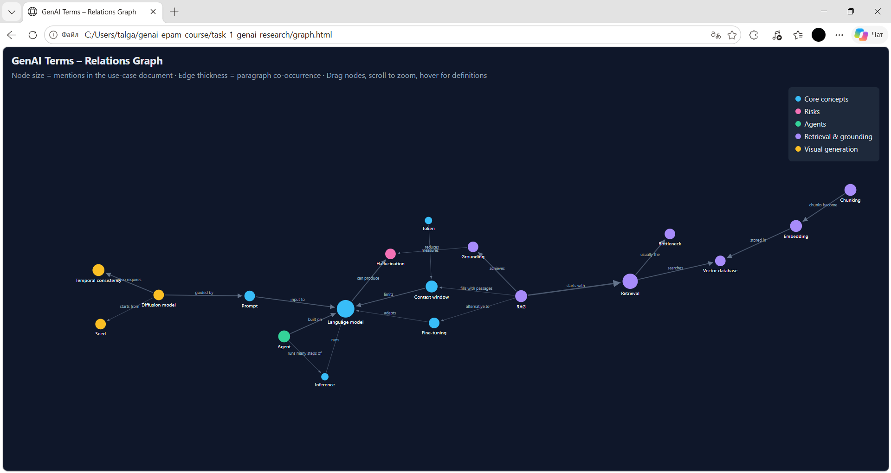

# GenAI Introduction Task

## Contents
- `research-report.md` – GenAI use cases (code assistants, RAG, visual generation)
- `vocabulary.md` – manually selected and explained GenAI terms
- `build_graph.py` – computes term statistics and builds the relations graph
- `graph_data.json` – generated data (mentions per term, co-occurrence per relation)
- `graph.html` – interactive graph (open in a browser)

## Relations graph

- Node size = number of mentions in `research-report.md`
- Edge thickness = number of paragraphs where both terms appear
- Colors = term category

## How to run
python build_graph.py

Then you can see graph.html, which shows the relations